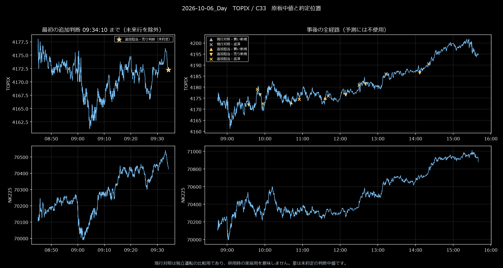
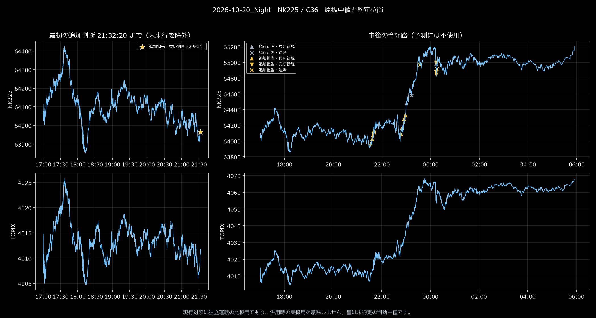

# どこで損失を増やし、何を直したか

## 調査と反論

参加制約の監査、データ・会計の監査、提案への反証、実装と比較の4担当で進めた。既知47場で、6種類の入口×3期間×2種類の投入・出口＝36設定を比較。それぞれ単独・現行との先着採用・独立枠の同時運転に分け、利益後再参加12設定と現行基準を加え、商品ごとに121運用を確認した。別に先物ペア9設定を比較した。同じ入口を異なる配分で使った結果を、121個の独立した予測理論とは数えない。

| 担当の指摘 | 実装・検証での対応 | 結果 |
|---|---|---|
| 朝の長指標準備、夜の米国開始待ち、利確後の内部波が参加を抑えている | 10・20・40分の別入口を作り、時刻禁止の大半を外して原板ごとに判断 | 参加を増やせるが、どの商品でも黒字が増えるわけではなかった |
| 追加担当が入ると、元担当の良い入口まで塞ぐ | 先着採用Cから独立枠Sへ変更し、旧勝ちを消さない | 日経の累計は改善。TOPIXでは旧損失も復活して悪化 |
| 利確後の再参加を厳しくしすぎていないか | 押し戻り・二市場支持・持続・待機だけの対照を比較 | 緩いR02は既知の日経で増益したが、追加3場では悪化 |
| 相対価格なら方向を当てなくて済むか | 元本差10%以内の整数ペアを、両脚別の次正常気配で売買 | P03は既知47場では小幅黒字、追加後は赤字。多くの無取引も残った |

## 先着採用の改善を、入口の高精度と取り違えない

**TOPIX・10月16日デイ**：C33の追加担当は09:40:52に4,074.5で2枚売り、15:35に4,082.5で返済して**−16,166円**。追加担当自体は負けていた。それでも保有中に来た現行の4親、合計**−79,172円**を見送ったため、口座の損失は縮んだ。

逆の例が**日経・10月22日デイ**。同じC33を当てると、09:48:11に64,620で2枚買い、10:05:39に64,350で返済して−54,154円。この保有が、現行の10:04:55の64,390売り5枚を塞いだ。現行なら13:59:29に63,510で返し、一連で＋323,616円だった。このため、TOPIX向けの先着採用を日経にも強制しない。

既知47場のTOPIX C33の改善＋154,489円は、追加79親の＋39,886円と、見送った旧17親の−114,603円から成る。日経C36は追加91親で＋638,638円を得ても、旧20親の＋681,626円を失って差引−42,988円だった。

**改修**：元担当最大5枚と追加担当最大5枚を別枠とするSを実装。先着競合は消せたが、TOPIXでは見送れていた負けも復活した。日経S36も最大赤字は拡大。配分の修正は入口の誤りを消すものではなかった。

## 固定後の追加3場で残った損失

**日経・10月22日ナイト**：S36追加担当が00:17:35に62,890で2枚買い、00:23:39に62,960で1枚、00:25:01に63,010で1枚追加。00:30:28に全4枚を62,780で損切りし、**−63,306円**。内訳は初回−22,154円、追撃−41,152円。短い反発の途中で買い増し、下落再開時に高い建玉ほど損を増やした。追加担当のこの場の合計−87,460円が現行＋49,232円を消した。

**日経・10月23日デイ**：追加担当の10:20:06の61,920買い2枚は、13:22:21の62,360返済で初回分＋87,846円。しかし後からの買い追撃3枚は−11,228円、さらに午後の反転売り2親で−73,384円を失い、追加担当全体は＋3,234円まで縮んだ。初回の方向は正しかったが、その後も同じ確度が続くとみなした追加・反転が利益を削った。

S36は3場とも口座赤字だったが、**追加担当自身が3場とも負けたのではない**。追加寄与は順に−87,460円・＋3,234円・＋11,846円。合計−72,380円が悪化分である。この3場の追加6親は全て反転側の入口で、追従との切替という名称だけから均衡した運用とは言えない。

**TOPIX・10月23日デイ**：C33は10:28:34に3,925.5で2枚買い、10:53:11に3,930で返して＋8,834円。その保有中、現行が10:28:41に出した3,923売り5枚を見送った。現行なら10:42:24に3,932.5で返済し−47,918円だった。さらに11:22:18の3,921買い2枚→11:46:39の3,940.5返済＋38,834円の間に、現行の遅い買い5枚・−35,418円も見送った。ただし他の追加売買を含めると、この日の追加担当は−20,410円、口座全体は−68,328円の赤字である。

**次の課題**は、反転玉の追撃で失った額と、追撃を外した場合に失う勝ちを同じ入口のまま比較すること、双方の担当が逆向きになった時の配分を調べること。追加3場を見た後の設定変更を、同じ3場による未見成功例として提出してはいない。今回の採否はこの失敗も含めて判断した。

## 画像で確認した対照

左は最初の追加判断時点まで、右は事後の全経路。▲買い新規・▼売り新規・×返済。星は判断中値であり、まだ約定していない。灰色の現行対照は独立運転の比較で、併用時に全て実採用されたという意味ではない。

ほかに [TOPIX10月21日](画像/TOPIX_2026-10-21_Day_C33.png)・[日経10月13日](画像/NK225_2026-10-13_Day_C36.png)。目視で思いついた解釈だけを優位性の証拠にはせず、原行と約定列の会計で確認した。

根拠：[旧47場の増減と具体売買](../../work/aggressive140_20261024/増減最大三場の具体売買140.md)、[追加3場の親別診断](../../work/aggressive140_20261024/追加3場の損失診断140.md)、[全条件集計](../../work/aggressive140_20261024/第二巡集計140.json)、[候補固定記録](../../work/aggressive140_20261024/固定候補140.json)。
