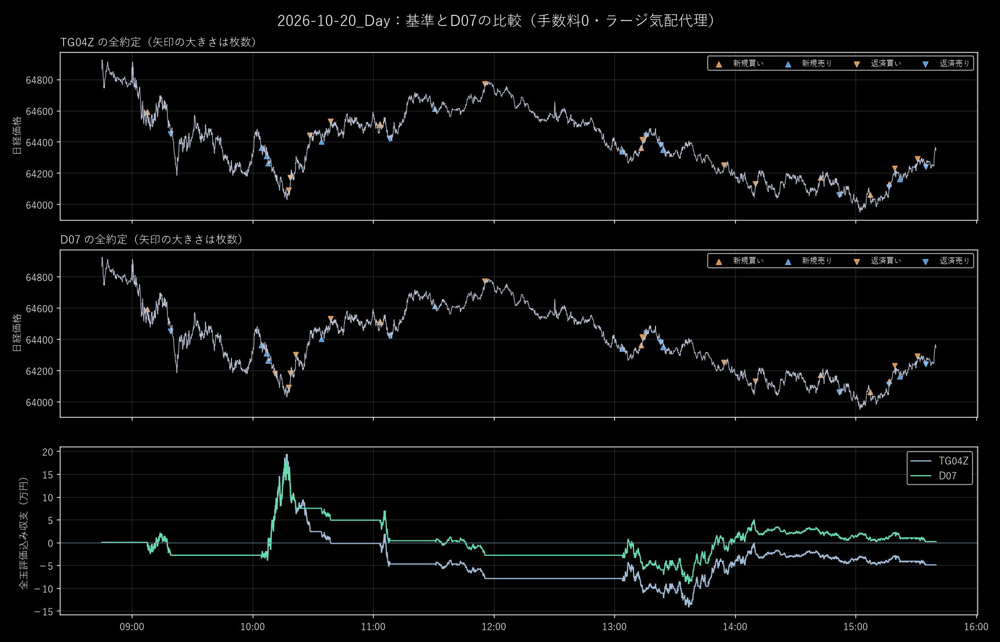
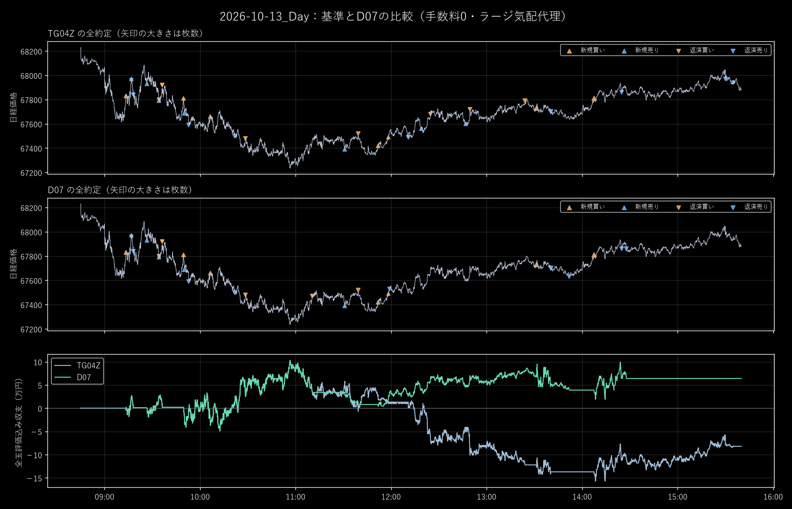
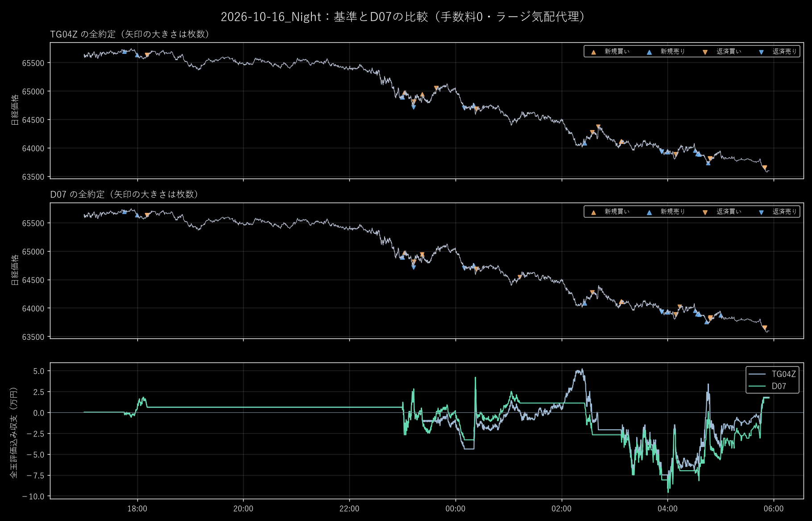
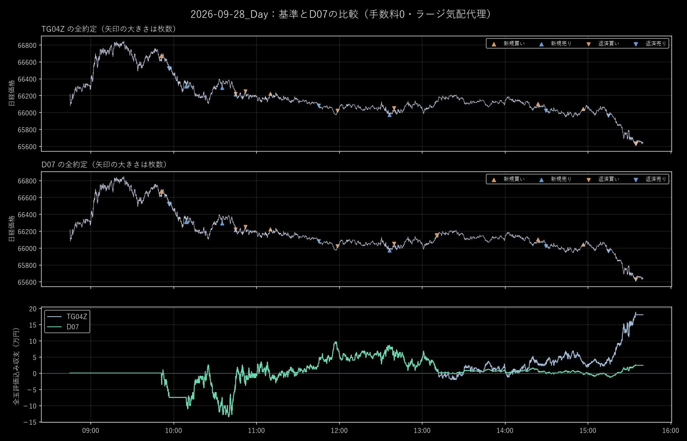

# 改善した場所と残った弱点

金額は日経mini、手数料0です。時刻は原データの価格時計で、独立した通信受信時刻ではありません。

## 10月20日デイ：部分利確後に利益を返す問題

10:07:12に64,310で売り5枚、10:18:03に64,090で2枚返済。元は残3枚を10:28:35の64,440まで持ち、この親の利益は5,000円でした。D07は10:18:57の64,180で残3枚を返し、この親を83,000円の利益で終えました。場全体は−49,000円から+2,000円です。

## 10月13日デイ：利益の戻しと午後の追加損失

09:50:15に67,690で売り5枚。元は2枚を部分利確した後、残3枚を13:24:06の67,790まで持ちました。D07の基本担当は11:10:30の67,470で返済し、この親の収支を12,000円から108,000円へ改善。追加担当の変更も含めた場全体は−82,000円から+64,000円でした。

## 10月16日ナイト：小反発を転換と誤認

翌04:52:48、短期指標は上向きでしたが40分差は−95pt。D03は63,860で2枚買って21,000円損失。D07はこのドテンを見送り、05:00:18に63,870で2枚売り、05:50:01の63,650で返して44,000円を得ました。場全体ではD03の−48,000円に対しD07は+17,000円です。

ただし、元TG04の場全体は+18,000円でした。この約2,000ptの下落を十分に稼ぐ点は、なお弱いままです。新改修が全ての大きな波を活用できたとは評価しません。

## 9月28日デイ：早く返して、その後の大きな下落を逃す

10:09:19に66,310で売り5枚、11:58:50に66,020で2枚返済。D07は13:10:42の66,150への戻りで残3枚を返しました。元は15:35の65,630まで持ったため、この変更で156,000円減益。場全体は+180,000円から+24,000円となりました。

追加担当の取り直しと、基本担当の同じ波への取り直しは別です。後者は今回のP01には実装しておらず、この反例は残ります。

詳細な原行・公開特徴・全注文は[検証の範囲](検証の範囲.md)の根拠資料から参照できます。
