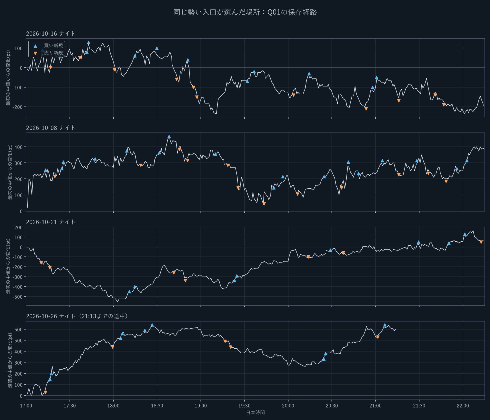

# 米国前そのものが不利なのか

**今回の25夜から「米国前だから利益を出しにくい」と一般化する根拠は得られなかった。一方、旧手法と現在D07の入口をそのまま米国前へ広げることには、実際に損失増の問題がある。**

## なぜ制限が残っていたか

最初の00128では、同じ20分帯突破の時刻条件だけを変更し、日経の21夜の収支が全夜−175,540円から米国後限定−78,840円へ改善した。旧日経マイクロ10枚・手数料込みの結果で、限定後も赤字だった。その後はこの米国後の核を引き継いで入口・出口を改善したが、現D07の前半解禁を毎回検証したわけではない。

現D07は主担当5枚を米国開始後22分まで待機させ、同じ枠の補完は30分後から。残る追加3枚と別入口2枚は前半も参加可能だが、40分の履歴や価格条件を要求する。『全担当が米国前を禁止』という設計ではない。

## 市場の性質を同じ長さで比較した

保存25夜で米国開始の5時間30分前〜15分前と、15分後〜5時間30分後を比較した。いずれも315分。夜ごとの値を集計し、原板の行数を独立標本数として扱わない。

| 観測 | 米国前 | 米国後 |
|---|---:|---:|
| 区間の高安幅・平均 | 581pt | 772pt |
| 分末気配差の中央値 | 10pt | 10pt |
| 確定1分価格の符号反転率・平均 | 50.1% | 49.2% |
| 事前値幅に合わせた同幅目標の先着率・接触時のみ | 39.8% | 39.5% |

最後の行は、固定した観測時点で買いと売りの両方を調べ、直前20分の値幅の半分（最低20pt）を順行・逆行の同じ幅とした事後観測。実際の戦略勝率ではない。どちらにも届かない場合を含めると36.2%／32.9%。固定100ptへの到達率だけでは、前半の値幅が小さい影響と方向の見分けやすさを混同する。

価格の5本・10本の傾きが一致する方向に限ると、前後双方で条件が成立した22夜の相対幅先着率は29.8%／38.6%。ただし夜単位で再標本化した差の95%区間は−25.4〜＋7.1ポイントで0を跨いだ。傾き追随が前半に合いにくい可能性はあるが、確証には不足する。完全な未見資料でもない。

## 10月26日の波を取れるQ01が他の夜に負けた理由

Q01自身の保存約定を再確認した。25夜の476玉中、損失は321玉。そのうち233玉は最大順行40pt未満で、利益保護を始める100ptへ届かず終わった損失玉は319玉。利益を乗せてから追尾する仕組みだけでは、そこへ届かない入口を救えない。

10月16日は、17:11買い→17:12損切り、17:16売り→17:21損切りと向きを変え、その後も短い上昇・下落を追った。前半−74万円。一方、10月21日は同じ条件で前半＋39.5万円だった。10月26日の波だけが例外的に取れたということではない。

同じ保存約定経路の−639万円を分解すると、中値変化が−253万円、買いで売気配・売りで買気配を使う気配差負担が−386万円。手数料は0円。これは中値で約定できる別戦略の成績ではなく、固定した約定経路の会計上の分解である。気配差だけでも、入口の予測だけでも全損失を説明しない。

## 今回言える範囲

米国前にも値幅があり、気配差や往復の頻度だけで全面静観を正当化できない。一方、最近の方向を確認したことと、そこから停止幅・利確開始幅を越えて継続することは別だった。前半専用の入口・出口を検討する余地は残るが、今回の時計解除だけではその優位性を作れていない。

市場には米国現物開始前も情報が入る。米国現物の開始時刻は日本先物そのものの開始時刻ではない。この制度上の事実と、特定の手法が利益を出せるかは別に検証した。[JPXの夜間取引](https://www.jpx.co.jp/derivatives/rules/trading-hours/01.html)、[NYSEの取引時間](https://www.nyse.com/markets/hours-calendars)。

詳しい定義・分子分母は損益xlsxの市場特性シート、元の集計は `work/preus149/data/`。損失の明細は[Q01の具体的な損失と勝ち](根拠/Q01の具体的な損失と勝ち.md)、採用の経緯は[米国前制限の採用根拠](根拠/米国前制限の採用根拠.md)を参照。
