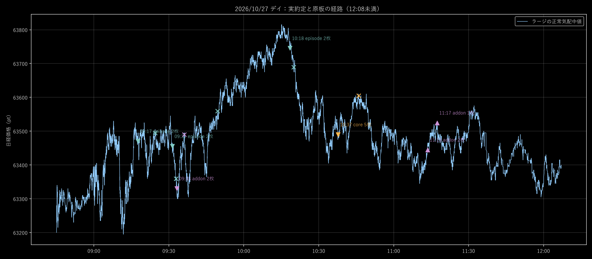

# 実運用で起きたこと

2026年10月27日デイのアプリ約定履歴と、同日12:08未満の保存原板を照合した。

## 枚数は確信度ではなかった

D07は、主担当5枚・追加担当3枚・別入口担当2枚の独立枠で動く。表示上の1枚は試し玉とは限らず、部分利確後に長い波を狙って残した玉でもある。別担当が後から新規に建てる動きと、同じ親取引への追撃を区別する必要がある。

## 今日の具体例

日経mini。順行幅はラージの返済側気配による代理計測、損益は実mini約定の手数料前。実際の画面に表示された最高含み益を復元した値ではない。

| 担当と取引 | 最大順行 | 実返済 | 手数料前収支 |
| --- | ---: | --- | ---: |
| 別入口：09:17:35に63,470.3売り2枚 | 09:21:21に約100.3pt | 09:24:28に63,494.7 | −4,880円 |
| 別入口：09:31:25に63,455.3売り、部分利確後の残り1枚 | 09:33:31に約155.3pt | 09:49:31に63,559.7 | −10,440円 |
| 追加担当の新規：09:33:13に63,330.3売り2枚 | 09:33:31に約30.3pt | 09:36:07に63,489.7 | −31,880円 |
| 主担当の新規：10:37:42に63,490売り5枚 | 10:41:18に約50pt | 10:46:00に63,604.7 | −57,350円 |

09:31の親では、先に返した1枚が＋9,560円でも、残り1枚が−10,440円となり、合計−880円へ反転した。残玉の返済理由は「実現利益の損失予算に到達」。確定した利益を残1枚の逆行へ再投入する設計と一致する。

一方、09:33の2枚と10:37の5枚は、同じ玉への追撃ではなく別担当の初回新規だった。これを「追撃に失敗した」とまとめると、直す条件を誤る。

主担当のD07利益保護は、黒字の部分返済が済んでから始まる。部分返済へ届かないまま反転した5枚には働かない。別入口の残1枚には、主担当の部分利確後保護が適用されていない。

## 未確定の扱い

取得時のアプリは11:21:41で停止。ユーザーが残りの売り1枚を手動決済したため、所有台帳との不一致が生じたことを確認済み。停止自体を今回の売買手法の失敗へ数えない。

アプリが記録した当日確定損益は手数料込み−90,505円で、取得した全当日約定の合計と一致する。ただし手動決済や管理外の玉を含めた口座全体・当日終了後の損益ではない。11:13の買い2枚と11:17の追加1枚について、停止後の実返済結果はこの履歴からは確定できない。

根拠：[実約定と原板の照合](../../work/d07_154/actual_diagnostic.json)、[入力の取得目録](../../work/d07_154/current_20261027/manifest.json)。
