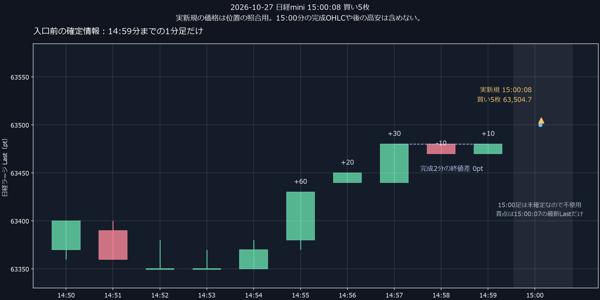

# 実運用で起きたこと

**15:00の買いでは、直前の失速を数値で検出できたのに、入口条件に使っていませんでした。** S01の主担当は中期の上昇と短い再上昇を重視し、その直前に進行が止まったことを見送り理由にしていません。

## 15:00:08の買い5枚

当時すでに完成していた日経ラージの1分終値は、14:54から順に **63,370 → 63,430 → 63,450 → 63,480 → 63,470 → 63,480**。前3分は＋110pt、最後2分は0ptです。買い前の停滞は、未来を見ずに判定できます。

一方、15:00に入った直後は再び上昇しています。現行条件はその動きを買いました。「上がったから必ず下がる」とは置かず、**停滞後の再上昇を買ってよい条件が不足していた**と捉え、入口拒否の効果を全過去日中で比較します。

[管理終了までの事後経路](15時新規の事後1分足.png)は別図です。上の図へ15:00分の完成足や後の高安を混ぜていません。

## 入口が悪い問題と、出口が遅い問題

| 実運用の玉 | 保有中の最大利益代理 | その後 |
|---|---:|---|
| 14:03:10 買い5枚・63,439.7 | 14:08:03に＋30,150円 | 14:28:36に返済。実収支−45,084円 |
| 14:52:20 売り2枚・63,375 | 14:52:43に＋5,000円 | 14:55:33に返済。実収支−10,094円 |
| 15:00:08 買い5枚・63,504.7 | 15:00:15に＋7,650円 | 15:00:34に利益消失。15:07の管理終了時は未返済 |

最大利益は**実mini建値とラージの返済側気配**で測った代理値です。miniの画面含みや、その価格で約定できた利益を保証する値ではありません。実収支は新規・返済の手数料込み。15:07のOFFを返済とみなした架空収支は作っていません。

14:03の買いは、入口後も約5分順行しました。この損失を「入口が高かった」だけで説明できません。**S01の新しい利益保護は別入口担当に限定され、主担当と追加担当には広い旧出口が残っていた**ことが、今回明らかになった問題です。

そのため、研究では①全担当の玉別固定幅保護、②失速した主担当初回を見送る入口、③両方の組合せを分けて比較します。判断価格は入口から返済までラージだけです。

元資料：[原板・実約定の診断](../../work/s01_156/実約定3区間の診断156.md)、[確定足と原行の照合](../../work/s01_156/実入口の失速条件156.md)。
