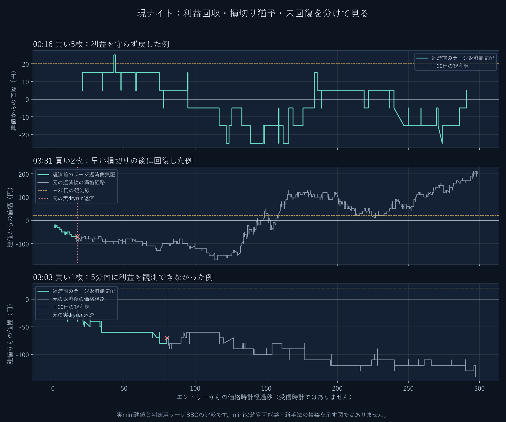

# 入口から何が起きたか

**利益になった玉を放置していることは、入口ごとの価格経路でも確認できました。** まず回収機会、次に初期損失、最後に再参加を分けて見ます。セッション損益だけで原因を決めません。

## 現ナイトの3例

10月28日ナイト、翌29日。実dryrunのmini建値と、判断用ラージの返済側気配を比較しています。秒数は価格時計で、独立した受信時計ではありません。

| 入口 | 入口後に起きたこと | 実際の返済 | 問題の種類 |
| --- | --- | --- | --- |
| 00:16:41 買5枚・64,655 | 約21秒で＋15円、43秒で＋25円、78秒で−5円 | 00:47:37・64,590、−32,500円 | 利益が出た後の保護が遅い |
| 03:31:16 買2枚・64,700 | 約114秒で−170円、149秒で＋20円、296秒で＋210円 | 17秒後に64,630、−14,000円 | 小さな初期停止で、その後の回復を逃す |
| 03:03:33 買1枚・64,640 | 5分内に正益を観測せず、最小−140円 | 80秒後に64,570、−7,000円 | 待つだけでは損失が増える場合 |

2・3行目の返済後の価格は、元の建値から価格を追った観測です。実際に保有して得た利益ではありません。ラージ気配はminiの約定可能価格そのものでもありません。

00167の初期診断はLastを代理価格にしました。今回は返済側BBOへ統一したため、最初の買玉の建値割れはLastの00:18:38より早い00:17:59に観測します。異なる価格定義を同じ時刻の結果として混ぜません。

## 既知の各入口でも起きるか

前40場の全261新規を、約定原行から5分の価格経路として追いました。5分は観測窓で、売買の保有時間制限ではありません。

| 観測した事象 | 件数 |
| --- | ---: |
| 5分内に一度は返済側気配で正益 | 206/261（78.9%） |
| その後、同じ窓で建値以下へ戻る | 200/206 |
| ＋20円へ到達 | 183/261 |
| ＋100円へ到達 | 38/261 |
| 最初の正益より先に中値が20円逆行 | 119/261 |
| 上の119件が、その後5分内に正益化 | 64/119（53.8%） |

最初の正益までの中央値は21.5価格時計秒。100円到達を待つ従来の入口担当は、小さな回収機会をかなり通過します。一方、初期逆行119件のうち55件は、この5分内では回復を観測しません。猶予を長くするだけを解決策にしません。

これは実保有中だけの集計ではありません。正益206件中6件、利益から建値以下へ戻った200件中8件は、元手法が既に全返済した後の観測です。78.9%を決済勝率・入口の校正済み確率とは呼びません。

＋20円から＋10円以下へ戻った173件では、次正常原行の気配も正益でした。ただし170件は同じ価格時計、131件は同じBid/Askの反復です。実際の注文でも全部取れる証明ではありません。300秒断面の遅延観測を、5分以内の極値へ混ぜていません。

## 利確後に何を失ったか

9月21日ナイトの保存比較では、23:00:01の買50micro・65,900を23:00:38・65,910で返し、＋5,000円を回収しました。その後23:01:05に33micro・65,940で再買い、23:05:30・65,820で−39,600円。回収益に対して再参加の損失許容量が大きすぎました。

初回が全く同じ純対照F12/F24でも、再参加玉の損益だけで日中−107,900円、米国前−9,600円、米国後−93,100円。再参加を足すだけでは改善しませんでした。元玉385件の判断から全返済までの同値を別担当が確認しています。

そこで別IDで、直近の方向確認、再参加専用50円停止、回収益の半分を留保する数量予算を追加しました。B13/B15は元玉が81対全て同じで、米国後の再参加損失は−378,800→−64,800円。これは予測精度の改善ではなく、損失に使う金額の縮小です。1玉では停止を判断できた時点で80円逆行し、留保を700円超過しました。留保は約定保証ではありません。

## 全体上位でも、残った玉を点検する

米国後U168B_09には、最大正益30/60/10/40円から240円損失になった4玉が残っていました。全て保護未起動です。『中値20円逆行を経た玉だけ守る』ため、資格前の利益を回収し損ねた例でした。

このため全体上位を完成とせず、第三巡でその資格を外しました。追加条件は、全玉の10円利益床、最高益50%床、8割の直接回収、初期猶予120/240円の不足セルです。結果は追加確認の表へ分け、旧手法の定義と成績を変更しません。

根拠：[現ナイトの原行付き観測](../../work/research168/現ナイトの入口後5分のBBO観測.json)、[261入口の観測](../../work/research168/micro_early/観測完了.json)、[入口統計](../../work/research168/入口直後の観測集計168.json)、[再参加の同値比較](../../work/research168/report/再参加の保存約定比較168.md)、[会計監査](../../work/research168/会計監査168.md)。
